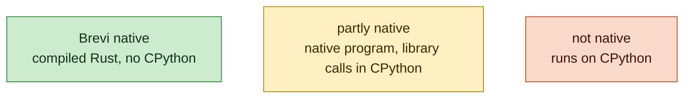
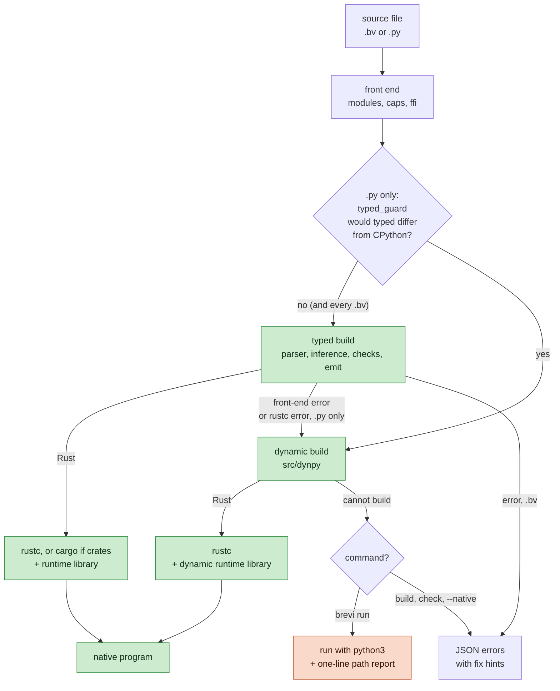
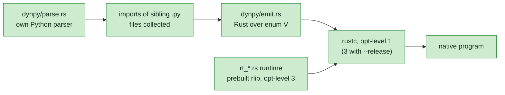
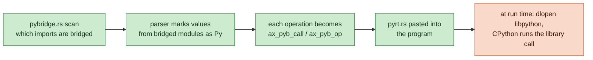

# How Brevi works

This document explains what Brevi does between a source file and a native program: which parts of `src/` run, in what order, and why. It describes `main` as of v0.24.

Brevi reads two kinds of input:

- **Brevi files (`.bv`)**: Brevi's own language, written for AI models (guide in `BREVI.md`).
- **Python files (`.py`)**: plain Python, built natively where Brevi can match CPython's answer ("Python in, Rust speed out").

Both end the same way: Brevi writes Rust source, and `rustc` turns it into a native program. Python files have more steps, because a Python file must give exactly CPython's output or not be built natively at all.

## What runs natively

Every diagram below colours its steps the same way:



| Path | Native? | What runs |
| --- | --- | --- |
| Typed build (every `.bv`, most `.py`) | **Brevi native** | Plain Rust with fixed types. The fastest path. |
| Dynamic build (`src/dynpy`) | **Brevi native** | Rust over a dynamic value type. No CPython anywhere. Slower than typed, usually faster than CPython. |
| Library calls (pybridge) | **Partly native** | The program is native; each call into numpy, pandas, etc. runs in CPython loaded into the program. |
| CPython fallback (`brevi run` only) | **Not native** | The whole file runs on `python3`, with a one-line path report on stderr. |

The release test counts how many final programs build natively (typed or dynamic, no fallback); the bar is 90%.

### Which path ran

`brevi run`, `brevi build` and `brevi check` say which of these paths a Python file took, as one JSON line on stderr, so an agent can tell when it is off the fast path and which function to rewrite:

```
{"path":"dynamic","line":12,"fn":"parse","why":"rows holds [int] (set on line 9) but is set to [str] here"}
{"path":"pybridge","why":"numpy run in CPython","py":["numpy"]}
{"path":"cpython","line":2,"fn":"g","why":"Brevi could not build it: unknown function eval()","by":"python3"}
```

| `path` | Meaning |
| --- | --- |
| `typed` | Typed build: the fast path. Not printed unless `--explain` or `BREVI_PATH=1`. |
| `pybridge` | Typed build; `py` lists the modules (and functions of Brevi's own modules it lacks, like `math.gcd`) that run in CPython. |
| `dynamic` | Dynamic build. `why` is the typed build's first refusal (or the guard's reason), `line` and `fn` where it is, `file` when it is in an imported module. `py`, when present, lists the libraries (and `open`) that CPython runs inside the program (see [Library calls](#library-calls-pybridge)). |
| `cpython` | `brevi run` handed the file to `python3` (`by`). `why` is Brevi's first build error. |

With `--explain` the line also carries the error's `fix`, up to five more typed errors (`also`), and for `cpython` why the dynamic build refused the file (`dynamic`). `BREVI_PATH=1` prints the line for every path, `BREVI_PATH=0` never. A failed build prints only its errors. The MCP server always sets `BREVI_PATH=1` and returns the report as `structuredContent` (see `mcp.rs`). The code is `say_path` in `main.rs`.

## The big picture



In words, for a Python file:

1. **Guard.** `typed_guard.rs` reads the file (and the local modules it imports) and looks for code the typed build would answer differently from CPython, such as printing a set. If it finds any, the typed build is skipped.
2. **Typed build (Brevi native).** The normal path: infer types, check, and emit plain Rust with fixed types. This is where the big speedups come from. Brevi's own spellings are mistakes in a `.py` file, so `pydiag.rs` stops on them before and after this build: Brevi syntax (`&&`, `x => x + 1`, `fn f(x):`), Brevi names (`true`, `fail("x")`), and a method only Brevi has, called on a value the typed build knows is a list, dict, text or number (`xs.push(1)`; a class's own `push` is fine).
3. **Dynamic build (Brevi native).** If the typed build fails at any stage (its own checks or `rustc`), `pydiag.rs` first looks at the typed errors for sure mistakes: a name that is never defined, a method no Python type has, or text added to a number. Code that may never run (under `sys.version_info`, `sys.platform`, `TYPE_CHECKING` or `if False`, and `except` blocks) is skipped. `check` and `build` report these as errors instead of building; `brevi run` falls back to python3 and names the mistake in its path report. Otherwise the file is rebuilt over a dynamic value type that behaves like CPython's objects. Still native, no CPython involved, with one `{"path":"dynamic"}` line saying why (see [Which path ran](#which-path-ran)).
4. **CPython fallback (not native).** Only if the dynamic build refuses too. `brevi run x.py` then runs the file with `python3` and prints one `{"path":"cpython"}` line on stderr. `brevi build`, `brevi check` and `--native` (or `BREVI_NATIVE=1`) never fall back; they print the errors.

A Brevi file only takes the typed path. Its errors go straight back to the model as JSON.

## Commands

All commands live in `src/main.rs`.

| Command | What it does |
| --- | --- |
| `brevi run FILE` | Build, then run. For `.py`, falls back to `python3` if no native build works. |
| `brevi build FILE [-o OUT]` | Build a native program. |
| `brevi check FILE [--fast]` | Front-end checks, then `rustc --emit=metadata` (no binary). `--fast` skips `rustc`. Replayed from the result cache when the files did not change. |
| `brevi test FILE` | Build with `--test` and run the program's `test` blocks. |
| `brevi emit FILE` | Print the generated Rust. |
| `brevi fix FILE` | Apply every suggested fix to the file. |
| `brevi patch FILE PATCH` | Replace whole functions/types by name (`src/patch.rs`). |
| `brevi guide [SECTION]` | Print the language guide or one section. |
| `brevi verify` | Native build against CPython on the same inputs, with a certificate (`src/verify.rs`). |
| `brevi mcp` | MCP server over stdin/stdout (`src/mcp.rs`): guide, check, run, test, verify, patch, edit, show. |

Flags: `--release` (opt-level 3), `--sandbox` (only what the caller grants with `--allow read,write,native` / `--allow-py MODULES`; the file's allow lines grant nothing), `--window` (real tkinter windows via egui), `--explain`, `--native`.

## Stage 1: front end

These steps run on the source text before parsing.

| Step | File | What it does |
| --- | --- | --- |
| Join files | `modules.rs` | `use "x.bv"`, and `import x` of a sibling `.py` file or package, are joined into one program. A segment table maps every line back to its file, so errors name the right file. |
| Capabilities | `caps.rs` | Under `--sandbox`, only what the caller grants (`--allow read,write,native`, `--allow-py MODULES`, the MCP `allow` / `allow_py` arguments) counts, and an allow line in the file that asks for more is refused. Without it, a program with `allow read, write` lines is held to them. A program that uses something not granted is refused, before any other path runs: a refused program is never built over dynamic values, through pybridge or run with python3. Python libraries (pybridge) need `allow native`, and a sandboxed program never falls back to python3. In a `.py` file the line may be a comment (`# allow read`). Path text (`os.path` functions, the `os` path constants and `pathlib.PurePath`) is built from Brevi's own Python copies (`src/dynpy/py`, over dynamic values, no file access) with or without the sandbox, so a program that only handles path text stays native; without `allow native`, `random` uses Brevi's copy too, and `caps::path_uses` refuses every other use of os and pathlib by name. |
| Foreign code | `ffi.rs` | `use CRATE "VER"`, `rust fn`, `py fn`, `rust:` and `py:` blocks. Foreign bodies are cut out and replaced by a stub on the same line, so line numbers stay put. Any crate switches the build to cargo. |
| Autofix | `main.rs` `autofix` | For `.bv` only: errors with a sure one-word fix (a typo of a known name) are fixed before the build and reported on stderr. Python files are never rewritten, because CPython would not rename `s.rpartition` either. |

A file counts as Python if it ends in `.py`, or if it uses spellings only Python code has (`def`, `class`, `import`, `None`, `.append(`, ...). See `python_style` in `main.rs`. Python mode turns on the Python-only passes below.

## Stage 2: the typed build

> **Brevi native.** Everything this stage produces is compiled Rust. Only values from bridged libraries (below) are handed to CPython.

```mermaid
flowchart LR
    A["lexer.rs<br/>tokens + indentation"] --> B["parser.rs<br/>AST (ast.rs)"]
    B --> C["gui.rs / pybridge.rs<br/>hooks during parsing"]
    C --> D["bigint.rs<br/>big-int promotion"]
    D --> E["alias.rs<br/>Python sharing"]
    E --> F["records.rs<br/>dicts as records"]
    F --> G["infer.rs<br/>types + checks"]
    G --> H["emit.rs auto_try<br/>error passing"]
    H --> I["moves.rs<br/>ownership"]
    I --> J["emit.rs<br/>Rust source"]
    classDef native fill:#cdeccf,stroke:#2f8a3e,color:#10301a
    classDef mixed fill:#fdf0c2,stroke:#b58a12,color:#3a2a00
    classDef cpython fill:#f9d9c9,stroke:#c0522b,color:#3a1405
    class A,B,D,E,F,G,H,I,J native
    class C mixed
```



The driver is `compile_once` in `main.rs`. In order:

1. **Lex and parse** (`lexer.rs`, `parser.rs`, `ast.rs`). One parser reads both Brevi and Python spellings into one syntax tree. Python forms are rewritten into Brevi ones as they are parsed: nested `def`s are lifted, `len`/`sum`/`append` become Brevi methods, classes become types with methods. A syntax error is a JSON line with the line number and, where it can, a fix.
2. **Parser hooks.** `gui.rs` takes calls on tkinter widgets. `pybridge.rs` marks every name that holds a value from a Python library (see [Library calls](#library-calls-pybridge)). Because a name can be used before the line that assigns it, the parser runs again while new names are found.
3. **Big integers** (`bigint.rs`, Python mode). Python ints have no size limit. A number read from text that is only added, multiplied, compared and printed becomes a big integer. Powers of literals are worked out at compile time, so `3 ** 50 % 1000000007` gives Python's answer.
4. **Sharing** (`alias.rs`, Python mode). In Python, `r = rows[k]; r[0] -= 1` changes `rows`. Brevi values are copies, so after each statement that changes `r` in place, the copy is written back (`rows[k] = r`). Where a change would still be lost, the build is refused instead of giving the wrong output.
5. **Records** (`records.rs`, Python mode). A dict with fixed string keys and values of different types (`{"n": n, "date": d, "posts": []}`) becomes a record type, like a class. It still prints as Python prints the dict and still serialises with `json.dumps`.
6. **Inference and checks** (`infer.rs`). Works out the types Brevi programs leave unstated: the item type of `xs = []` from later uses, return types, which parameters a function changes (`auto_mut`), and which method a call on an object means. Then `infer::check` runs Brevi's own type checker, with short errors such as "str + int" or "type changes from int to str", each with a fix.
7. **Error passing** (`emit.rs` `auto_try`). A call to a function that can fail passes its error up unless the code already handles it, so programs need no `?`.
8. **Ownership** (`moves.rs`). A variable's last read moves the value instead of copying it. If moving breaks Rust's borrow rules, the build retries without moves (see Stage 4).
9. **Emit** (`emit.rs`). Writes one Rust file: the runtime prelude, then the program. Each statement records its source line (`ax_l(n)`), so a runtime error can name the Brevi or Python line.

The typed build may also ask `pybridge::learn` to bridge a missing library function (for example `math.gcd`) and build again, up to 8 rounds (`compile_to_rust`).

### What "Python behaviour" means in the typed build

The typed build copies the CPython behaviour that shows in a program's output: integer size (`bigint.rs`), shared objects (`alias.rs`), dict printing and JSON (`records.rs`), set membership with a hash index (`emit::FAST_SETS`), Python's float and `round` formatting, exception messages (`ax_exc_msg` in `prelude.rs`), and so on. Anything it cannot match is not built typed. Either the typed build refuses it (and the dynamic build gets a turn), or `typed_guard.rs` sends it to the dynamic build before the typed build starts.

## The guard: when typed would be wrong

Some Python programs type cleanly but would still print something different from CPython. `typed_guard.rs` finds them on the Python syntax tree (it reuses the dynamic build's parser) and sends them straight to the dynamic build. Current cases:

- **Set order.** The typed build keeps a set sorted. CPython walks a set in hash-table order (`{3, -1, 5}` prints `{3, 5, -1}`). Printing, iterating, `list(s)`, `s.pop()` or joining a set goes dynamic. Order-free uses (`x in s`, `len`, `sorted`, `min`, `sum`, set algebra, and a comprehension over a set handed straight to `max`, `sorted`, `any`, `len` and the like) stay typed. A set of strings (or of tuples led by one) has no fixed order in CPython, whose string hashes change every run, so walking or printing it stays typed too: `check_soft` names the sets, `emit` adds an `ax_rand_set(&name)` mark after each place one is set, and rustc only accepts it when the elements are strings (`AxRandElem` in `prelude.rs`). If any mark fails, the file goes where the guard would have sent it.
- **`tuple(xs)` printed.** The typed build holds such a tuple as a list, so `print(tuple(xs))` would show `[1, 2]`. The guard follows such values into lists, through a helper's parameter (`out.append(tuple(cur))`) and through returns; `m.groups()` counts as one too.
- **Argument order.** `print(q, q.popleft())`, `print(xs, grow(xs))`, `r = (q, q.pop())`: CPython reads every argument first and shows the object itself; the typed build copies each argument as it goes, so `q` would show the value from before the change. For calls, the guard works out what each function of the file changes in place (`program_changes`: its parameters, globals and closure names, through the functions it calls), and sends the file off when a later print argument, or tuple or list item, changes what an earlier one holds. Functions in other modules are not followed.
- **Regex matches** printed directly (`<re.Match object ...>` versus a list of groups). (A group that did not match is the None string in a typed match, so `m.group(2) is None` and printing it stay typed.)
- **Changing a dict or set while looping over it**, which CPython stops with an error.
- **Generators** that cannot safely be run early. The typed build turns a generator into a function that returns a list, which is only correct when running it early cannot be told apart.

A file the guard cannot read (its parser rejects it) has passed none of these checks, so the typed build may not build it either: if the typed front end accepts it, it is refused with the guard's reason. A file the typed build refuses too keeps the typed errors. Either way `brevi run` falls back to CPython.

`BREVI_GUARD=print brevi build x.py` prints the guard's verdict.

Before the guard and the typed build, `pysentinel.rs` rewrites a sentinel `MISSING = object()` to None when the program cannot tell the two apart (see the rules at the top of that file).

## Stage 3: the dynamic build (`src/dynpy`)

> **Brevi native.** No CPython is involved: the program and its runtime are compiled Rust.

For Python files the typed build cannot handle, such as a variable that holds an int and later a string, or a list of mixed values.



- **Its own parser** (`dynpy/parse.rs`) for a supported subset of Python. Anything outside the subset is an error at build time with a line number.
- **The whole program goes dynamic**, not single variables. Every value is a `V` enum (int, float, str, list, dict, object, ...) with CPython's semantics: CPython's hashing and set order, its formatting, its exceptions, classes and method lookup.
- **Runtime** (`rt_core` values, `rt_ops` operators, `rt_fmt` formatting, `rt_call` calls and classes, `rt_lib` builtins, `rt_mod` stdlib modules, `rt_text` regex engine and json, `rt_ext` decimal/fractions/datetime/csv/statistics/html/threading, `rt_enum` enum, `rt_glue` helpers the emitted code calls, `rt_gen` generators, plus the small-object allocator `alloc_rt.rs`). It is built once per rustc version into `~/.cache/brevi/dynrt/<hash>` and linked into each program.
- **Modules.** 26 standard modules are built in (`BUILTIN_MODULES` in `dynpy/emit.rs`: math, re, json, json.decoder, collections, itertools, enum, decimal, datetime, csv, ...). A few more are Brevi's own Python copies in `src/dynpy/py`, compiled with the program like its own files: path text from `os`, `os.path` and `pathlib`, `io.StringIO`, and `random` under the sandbox (`dynpy::sandbox_module`). Any other import (requests, pydantic, yaml, sqlite3, logging, ...) is bridged: CPython runs that library inside the program, and the rest stays native (see [Library calls](#library-calls-pybridge)). Without `allow native` under the sandbox, or without a python3 that has libpython, those imports are refused at build time.
- **Refuse at build time, never at run time.** Anything unsupported (`module_has`, `is_missing_builtin`) must stop the build, so `brevi run` can still fall back to CPython. A program that builds must give CPython's output.

Typed builds are faster. The dynamic build was about 1.3x CPython on micro benchmarks and 4.5x on the `minilang` tests when it landed.

Switches: `BREVI_DYN=1` forces the dynamic build, `BREVI_DYN=0` disables it, `BREVI_DYN_DEBUG=1` prints `rustc` errors from generated code.

## Library calls (pybridge)

> **Partly native.** The program is native; only the library calls themselves run in CPython.

For Python files that import libraries Brevi does not build itself (numpy, pandas, requests, sqlite3, argparse, ...).



- `pybridge::scan` reads the import lines. A module Brevi has built in (math, re, json, collections, ...) stays native. Any other module is bridged.
- The parser asks `pybridge.rs` about every name: a bridged module, a name imported from one, and every value made from those (`a = np.array(xs)`, `a.sum()`, `a * 2`) has type `Py`.
- Each operation on a `Py` value becomes a call into the runtime (`ax_pyb_call(o, "sum", ...)`, `ax_pyb_op("+", a, b)`). The runtime (`pyrt.rs`, pasted into the program only when needed) loads `libpython` the first time a library is used, so the result is CPython's own.
- The rest of the program stays native. Brevi values are converted on the way in; Python values come back as Brevi values only through `int()`, `float()`, `str()`, `bool()` and `len()`.
- The program needs `libpython` on the machine where it runs, unless it is built with `--standalone`. That build appends CPython, the shared libraries it needs (glibc aside), the standard library and the imported packages to the binary (`src/pybundle.py`), and `pyrt.rs` unpacks them once into `~/.cache/brevi/py/<hash>` and loads libpython from there. Standalone builds are Linux only, and nothing here runs on Windows.
- A library program the typed build rejects goes to the dynamic build, which bridges the same libraries its own way (`src/dynpy/pyglue.rs`, pasted after `src/pyrt_load.rs`, the loader both bridges share). A library value is an `Ext` value holding a Python object, and every operation on it runs in CPython. None, bools, numbers, strings, bytes and tuples cross as the program's own values. Lists, dicts and sets returned by a call are copied in, and those reached through an attribute or item stay the library's own objects, so `post.tags.append(x)` changes what the library sees. A list or dict the program passes in and the library changes is copied back after the call. Functions of the program go in as Python callables, and exceptions keep their class names, bases and attributes both ways. Without bridging, `open()` is refused by the dynamic build. With bridging, `open()` is CPython's.
- A class built on a library class (`class Post(BaseModel)`, or a class with a library decorator) is run by CPython whole. Its lines are compiled in a Python module named like the program's, after that file's import lines (`dynpy::lib_classes`). Such a class is refused, so the file runs in CPython, in three cases: it sits inside a function or block, it uses a name of the program that CPython cannot see, or a class in another file builds on it.
- The `{"path":"dynamic"}` line names what CPython runs (`"py":[...]`). The dynamic runtime itself still reaches no file, process or CPython. The bridge code is added to the program only when the program imports a library.

## Stage 4: compiling the Rust

> **Brevi native.** Typed and dynamic builds both end here, as a native executable.

```mermaid
flowchart TD
    V["up to 4 versions of the Rust<br/>(hash-indexed sets on/off x inferred types on/off)<br/>each with and without moves"] --> K{"build cache hit?<br/>~/.cache/brevi/bin"}
    K -- "yes" --> OUT["copy or hard-link binary"]
    K -- "no" --> C{"crates?"}
    C -- "no" --> RC["rustc, linked against<br/>prelude rlib (dev)<br/>or pasted prelude (--release)"]
    C -- "yes" --> CG["cargo build<br/>shared target dir"]
    RC -- "ok" --> OUT
    CG -- "ok" --> OUT
    RC -- "borrow error" --> PLAIN["retry same version<br/>without moves"]
    RC -- "other error" --> NEXT["try next version"]
    NEXT --> REP["no version builds: map rustc<br/>errors back to source lines (JSON)"]
    classDef native fill:#cdeccf,stroke:#2f8a3e,color:#10301a
    classDef mixed fill:#fdf0c2,stroke:#b58a12,color:#3a2a00
    classDef cpython fill:#f9d9c9,stroke:#c0522b,color:#3a1405
    class RC,CG,OUT native
```



- **Versions.** The typed build makes up to four Rust versions of the program: with and without inferred types for empty values, and with and without hash indexes for Python's searched lists. Each also has a variant without moves. `rustc` gets them in order; the first that compiles wins. Errors are reported from the first version, since its inferred types name the real gap. Only the first version is made up front: each other one is a whole front-end pass, made only when the versions before it failed (making all eight first cost a cached check up to 5 s).
- **Runtime library.** The prelude (`prelude.rs` plus `alloc_rt.rs`, about 6,000 lines) is built once per rustc version into `~/.cache/brevi/rt/` as an rlib at opt-level 3. Normal builds link it and compile only the program at opt-level 1, which skips type-checking the prelude on every build. `--release` pastes the prelude into the program instead, so its functions can be inlined, and compiles at opt-level 3.
- **Crates.** A program with `use CRATE "VER"` builds through cargo, with one shared target dir (`$BREVI_CACHE` or `~/.cache/brevi/target`).
- **Result cache** (`runcache.rs`). `check`, `build` and `run` (and `run`'s inner build for a Python file) run the build as a child `brevi check` or `brevi build` with `BREVI_PHASE=1`, and keep what it printed, its exit code and its binary in `~/.cache/brevi/runs/`, under a hash of the program's files (every `.py` and `.bv` file in its folder and the folders its imports and `use` lines reach), the command and flags, the `BREVI_*` and Python settings, the Brevi binary (version, size, time) and the toolchain. An unchanged program then replays in about 10 ms with no front end and no `rustc`, path report line included; the MCP server's calls get this too. A refusal is kept only when the program imports nothing outside its folder and the standard library, and never one without a line in the program (an error about the machine).
- **Build cache.** Below it, builds are cached by a hash of the generated code, the flags, the rustc version and the prelude, so a program whose generated Rust did not change skips `rustc`. Failed builds are cached too, except errors that point at no code (a folder that could not be written). Both caches together keep at most `BREVI_CACHE_MB` megabytes (default 1024), least recently used first out. `--no-cache` or `BREVI_NO_CACHE=1` turns both off.
- **rustc itself.** Brevi asks the rustup proxy once for the toolchain's sysroot and then calls that rustc directly (each proxy call costs 20 to 50 ms). The answer is kept in `~/.cache/brevi/toolchain/` under a key of PATH, the RUSTUP_* settings, rustup's settings file and any rust-toolchain file above the working directory. Builds without `--release` use one codegen unit per core (4 to 16) instead of rustc's 16, which builds small programs about 20% faster on 4 cores. Not done, a possible future option behind a flag: rustc's incremental mode keyed by source file makes a rebuild after an edit about 28% faster but a first build about 22% slower, and most agent runs are first builds.
- **Error mapping.** `report` reads `rustc --error-format=json`, maps each span back to a source line through the `/*@Ln*/` markers in the generated code, rewrites Rust words into Brevi words, and prints one short JSON line per error with a fix where one is known (`diag.rs`). For Python files these errors are held back until the dynamic build has had its turn.
- **Flags.** `rustc --edition 2021 -C overflow-checks=on`, debug info stripped (runtime errors carry source line numbers instead).

## Stage 5: running

> **Brevi native**, unless the CPython fallback below is used, which is **not native**.

`brevi run` runs the built program with the arguments after `--` and exits with its status. A runtime error prints one JSON line: `{"e":"runtime","line":N,"msg":"..."}`, with the message in Python's words for Python files.

For `brevi run x.py` without `--native`, Brevi runs a strict build of itself as a child process. If that fails, it runs `python3 x.py` (or `$BREVI_PYTHON`) and prints a `{"path":"cpython",...}` line on stderr naming the line, function and error that stopped Brevi, so an agent always gets a result and knows it ran on CPython. If there is no Python either, it prints Brevi's errors.

## Other pieces

| File | Role |
| --- | --- |
| `gui.rs`, `gui_glue.rs`, `runtime/brevi_tk` | tkinter programs compiled onto the `brevi_tk` runtime. Headless by default (prints the window as text, reads actions from stdin); `--window` draws real windows with egui. |
| `diag.rs` | The JSON error format: `{"line":..,"msg":..,"fix":..}`, plus machine-applicable edits used by autofix and `brevi fix`. |
| `patch.rs` | `brevi patch`: edit by whole items, so a retry costs only the change. |
| `mcp.rs` | `brevi mcp`: keeps the program in the server so tools can send only changes. |
| `json.rs` | Minimal JSON reader for rustc's error output. |
| `grammar/` | A Lark grammar of Brevi for constrained decoding; CI parses every test program with it. |

## Where to look when

| Question | Start in |
| --- | --- |
| Why did my Python file build dynamically? | `BREVI_GUARD=print`, then `BREVI_DYN=0 brevi build x.py` to see the typed errors |
| What Rust did Brevi write? | `brevi emit x.py` (typed) or `BREVI_DYN=1 brevi emit x.py` (dynamic) |
| Why did `brevi run` use CPython? | The `{"path":"cpython"}` line on stderr names the first error and its function; `brevi run --native x.py` shows them all |
| A wrong answer compared with CPython | `tools/parity_probe.py`; typed fixes go in `infer.rs`/`emit.rs`/`prelude.rs`, dynamic ones in `dynpy/rt_*.rs` |
| A new Python library | `pybridge.rs` (`NATIVE` list decides what stays native) |

## Tests

- `tests/check.sh`: every program in `tests/run` and `tests/errors` must match its `.expected` file; `tests/dyn/*.py` run with `BREVI_DYN=1` against `python3`'s output; `tests/fallback` covers the CPython fallback.
- `bench/verify.sh OLD NEW`: every saved benchmark solution must still give the same output.
- `tools/compat.py check`: every solution in `compat/baseline.txt` must keep building on new Rust and Python releases.
- `sh tools/ci_local.sh`: the PR checks, run locally before merging.
