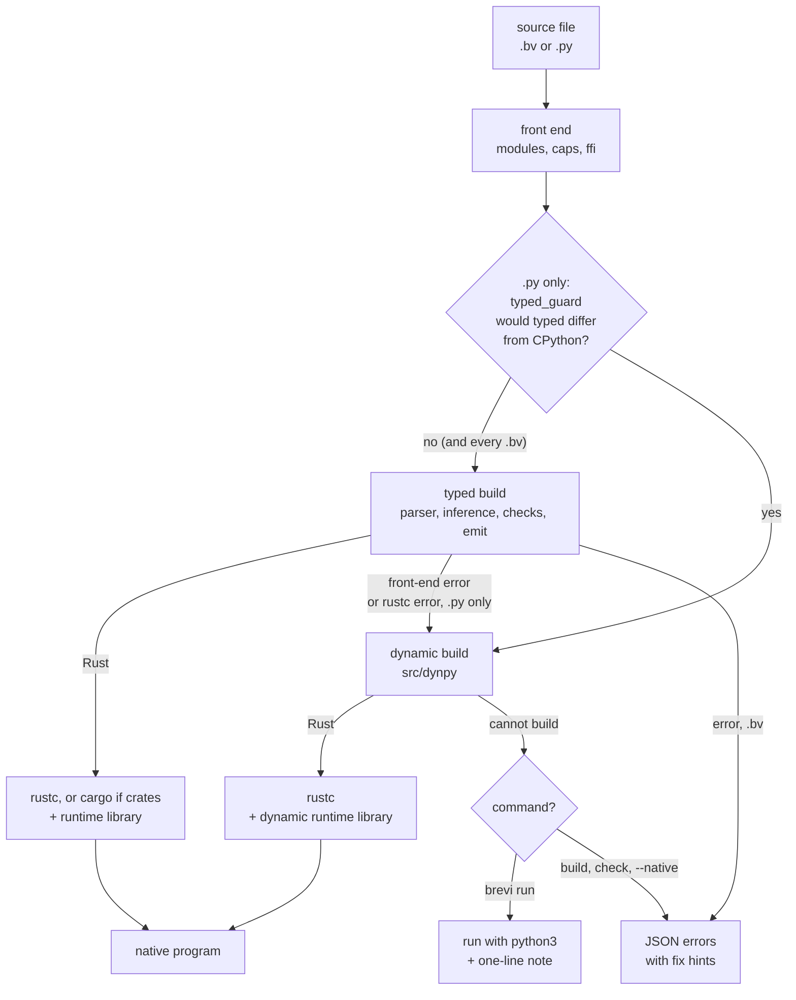
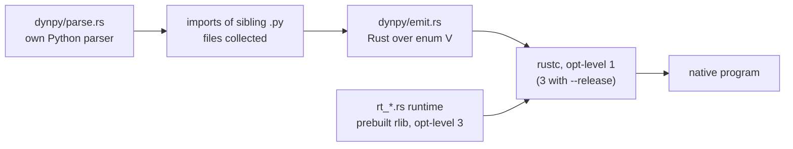
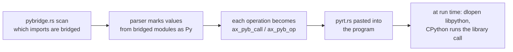
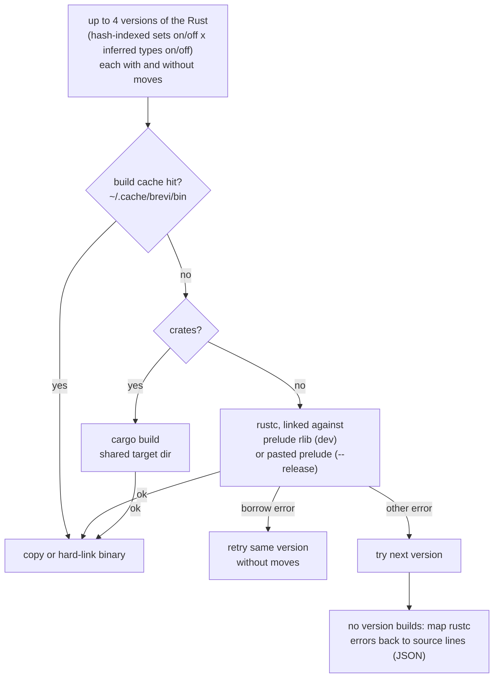

# How Brevi works

This document explains what Brevi does between a source file and a native program: which parts of `src/` run, in what order, and why. It describes `main` as of v0.22.

Brevi reads two kinds of input:

- **Brevi files (`.bv`)**: Brevi's own language, written for AI models (guide in `BREVI.md`).
- **Python files (`.py`)**: plain Python, built natively where Brevi can match CPython's answer ("Python in, Rust speed out").

Both end the same way: Brevi writes Rust source, and `rustc` turns it into a native program. Python files have more steps, because a Python file must give exactly CPython's output or not be built natively at all.

## The big picture

In words, for a Python file:

1. **Guard.** `typed_guard.rs` reads the file (and the local modules it imports) and looks for code the typed build would answer differently from CPython, such as printing a set. If it finds any, the typed build is skipped.
2. **Typed build.** The normal path: infer types, check, and emit plain Rust with fixed types. This is where the big speedups come from.
3. **Dynamic build.** If the typed build fails at any stage (its own checks or `rustc`), the file is rebuilt over a dynamic value type that behaves like CPython's objects. Still native, no CPython involved, and silent: the user just gets a program.
4. **CPython fallback.** Only if the dynamic build refuses too. `brevi run x.py` then runs the file with `python3` and prints one note on stderr. `brevi build`, `brevi check` and `--native` (or `BREVI_NATIVE=1`) never fall back; they print the errors.

A Brevi file only takes the typed path. Its errors go straight back to the model as JSON.

## Commands

All commands live in `src/main.rs`.

| Command | What it does |
| --- | --- |
| `brevi run FILE` | Build, then run. For `.py`, falls back to `python3` if no native build works. |
| `brevi build FILE [-o OUT]` | Build a native program. |
| `brevi check FILE [--fast]` | Front-end checks, then `rustc --emit=metadata` (no binary). `--fast` skips `rustc`. |
| `brevi test FILE` | Build with `--test` and run the program's `test` blocks. |
| `brevi emit FILE` | Print the generated Rust. |
| `brevi fix FILE` | Apply every suggested fix to the file. |
| `brevi patch FILE PATCH` | Replace whole functions/types by name (`src/patch.rs`). |
| `brevi guide [SECTION]` | Print the language guide or one section. |
| `brevi mcp` | MCP server over stdin/stdout (`src/mcp.rs`): guide, check, run, test, patch, edit, show. |

Flags: `--release` (opt-level 3), `--sandbox` (enforce `allow` lines), `--window` (real tkinter windows via egui), `--explain`, `--native`.

## Stage 1: front end

These steps run on the source text before parsing.

| Step | File | What it does |
| --- | --- | --- |
| Join files | `modules.rs` | `use "x.bv"`, and `import x` of a sibling `.py` file or package, are joined into one program. A segment table maps every line back to its file, so errors name the right file. |
| Capabilities | `caps.rs` | `allow read, write` lines. With `--sandbox`, or any `allow` line, a program that uses something it did not declare is refused. |
| Foreign code | `ffi.rs` | `use CRATE "VER"`, `rust fn`, `py fn`, `rust:` and `py:` blocks. Foreign bodies are cut out and replaced by a stub on the same line, so line numbers stay put. Any crate switches the build to cargo. |
| Autofix | `main.rs` `autofix` | For `.bv` only: errors with a sure one-word fix (a typo of a known name) are fixed before the build and reported on stderr. Python files are never rewritten, because CPython would not rename `s.rpartition` either. |

A file counts as Python if it ends in `.py`, or if it uses spellings only Python code has (`def`, `class`, `import`, `None`, `.append(`, ...). See `python_style` in `main.rs`. Python mode turns on the Python-only passes below.

## Stage 2: the typed build

The driver is `compile_once` in `main.rs`. In order:

1. **Lex and parse** (`lexer.rs`, `parser.rs`, `ast.rs`). One parser reads both Brevi and Python spellings into one syntax tree. Python forms are rewritten into Brevi ones as they are parsed: nested `def`s are lifted, `len`/`sum`/`append` become Brevi methods, classes become types with methods. A syntax error is a JSON line with the line number and, where it can, a fix.
2. **Parser hooks.** `gui.rs` takes calls on tkinter widgets. `pybridge.rs` marks every name that holds a value from a Python library (see [Library calls](#library-calls-pybridge)). Because a name can be used before the line that assigns it, the parser runs again while new names are found.
3. **Big integers** (`bigint.rs`, Python mode). Python ints have no size limit. A number read from text that is only added, multiplied, compared and printed becomes a big integer. Powers of literals are worked out at compile time, so `3 ** 50 % 1000000007` gives Python's answer.
4. **Sharing** (`alias.rs`, Python mode). In Python, `r = rows[k]; r[0] -= 1` changes `rows`. Brevi values are copies, so after each statement that changes `r` in place, the copy is written back (`rows[k] = r`). Where a change would still be lost, the build is refused instead of giving the wrong output.
5. **Records** (`records.rs`, Python mode). A dict with fixed string keys and values of different types (`{"n": n, "date": d, "posts": []}`) becomes a record type, like a class. It still prints as Python prints the dict and still serialises with `json.dumps`.
6. **Inference and checks** (`infer.rs`). Works out the types Brevi programs leave unstated: the item type of `xs = []` from later uses, return types, which parameters a function changes (`auto_mut`), and which method a call on an object means. Then `infer::check` runs Brevi's own type checker, with short errors such as "str + int" or "type changes from int to str", each with a fix.
7. **Error passing** (`emit.rs` `auto_try`). A call to a function that can fail passes its error up unless the code already handles it, so programs need no `?`.
8. **Ownership** (`moves.rs`). A variable's last read moves the value instead of copying it. If moving breaks Rust's borrow rules, the build retries without moves (see Stage 4).
9. **Emit** (`emit.rs`). Writes one Rust file: the runtime prelude, then the program. Each statement records its source line (`ax_l(n)`), so a runtime error can name the Brevi or Python line.

The typed build may also ask `pybridge::learn` to bridge a missing library function (for example `math.gcd`) and build again, up to 8 rounds (`compile_to_rust`).

### What "Python behaviour" means in the typed build

The typed build copies the CPython behaviour that shows in a program's output: integer size (`bigint.rs`), shared objects (`alias.rs`), dict printing and JSON (`records.rs`), set membership with a hash index (`emit::FAST_SETS`), Python's float and `round` formatting, exception messages (`ax_exc_msg` in `prelude.rs`), and so on. Anything it cannot match is not built typed. Either the typed build refuses it (and the dynamic build gets a turn), or `typed_guard.rs` sends it to the dynamic build before the typed build starts.

## The guard: when typed would be wrong

Some Python programs type cleanly but would still print something different from CPython. `typed_guard.rs` finds them on the Python syntax tree (it reuses the dynamic build's parser) and sends them straight to the dynamic build. Current cases:

- **Set order.** The typed build keeps a set sorted. CPython walks a set in hash-table order (`{3, -1, 5}` prints `{3, 5, -1}`). Printing, iterating, `list(s)`, `s.pop()` or joining a set goes dynamic. Order-free uses (`x in s`, `len`, `sorted`, `min`, `sum`, set algebra) stay typed.
- **Argument order.** `print(q, q.popleft())`: CPython reads every argument first; the typed build would print `q` before the pop.
- **Regex matches** printed directly (`<re.Match object ...>` versus a list of groups).
- **Changing a dict or set while looping over it**, which CPython stops with an error.
- **Generators** that cannot safely be run early. The typed build turns a generator into a function that returns a list, which is only correct when running it early cannot be told apart.

`BREVI_GUARD=print brevi build x.py` prints the guard's verdict.

## Stage 3: the dynamic build (`src/dynpy`)

For Python files the typed build cannot handle, such as a variable that holds an int and later a string, or a list of mixed values.

- **Its own parser** (`dynpy/parse.rs`) for a supported subset of Python. Anything outside the subset is an error at build time with a line number.
- **The whole program goes dynamic**, not single variables. Every value is a `V` enum (int, float, str, list, dict, object, ...) with CPython's semantics: CPython's hashing and set order, its formatting, its exceptions, classes and method lookup.
- **Runtime** (`rt_core` values, `rt_ops` operators, `rt_fmt` formatting, `rt_call` calls and classes, `rt_lib` builtins, `rt_mod` stdlib modules, `rt_text` regex engine and json, `rt_ext` decimal/fractions/datetime/csv/statistics/html/threading, `rt_gen` generators, plus the small-object allocator `alloc_rt.rs`). It is built once per rustc version into `~/.cache/brevi/dynrt/<hash>` and linked into each program.
- **Modules.** 24 standard modules are built in (`BUILTIN_MODULES` in `dynpy/emit.rs`: math, re, json, collections, itertools, decimal, datetime, csv, ...). Any other import is refused at build time. That includes libraries such as numpy: the dynamic build does not bridge to CPython.
- **Refuse at build time, never at run time.** Anything unsupported (`module_has`, `is_missing_builtin`) must stop the build, so `brevi run` can still fall back to CPython. A program that builds must give CPython's output.

Typed builds are faster. The dynamic build was about 1.3x CPython on micro benchmarks and 4.5x on the `minilang` tests when it landed.

Switches: `BREVI_DYN=1` forces the dynamic build, `BREVI_DYN=0` disables it, `BREVI_DYN_DEBUG=1` prints `rustc` errors from generated code.

## Library calls (pybridge)

For Python files that import libraries Brevi does not build itself (numpy, pandas, requests, sqlite3, argparse, ...).

- `pybridge::scan` reads the import lines. A module Brevi has built in (math, re, json, collections, ...) stays native. Any other module is bridged.
- The parser asks `pybridge.rs` about every name: a bridged module, a name imported from one, and every value made from those (`a = np.array(xs)`, `a.sum()`, `a * 2`) has type `Py`.
- Each operation on a `Py` value becomes a call into the runtime (`ax_pyb_call(o, "sum", ...)`, `ax_pyb_op("+", a, b)`). The runtime (`pyrt.rs`, pasted into the program only when needed) loads `libpython` the first time a library is used, so the result is CPython's own.
- The rest of the program stays native. Brevi values are converted on the way in; Python values come back as Brevi values only through `int()`, `float()`, `str()`, `bool()` and `len()`.
- The program needs `libpython` on the machine where it runs. Not supported on Windows.
- This is part of the **typed** build only. A library program the typed build rejects goes to the dynamic build, which refuses unknown imports, so `brevi run` falls back to CPython.

## Stage 4: compiling the Rust

- **Versions.** The typed build makes up to four Rust versions of the program: with and without inferred types for empty values, and with and without hash indexes for Python's searched lists. Each also has a variant without moves. `rustc` gets them in order; the first that compiles wins. Errors are reported from the first version, since its inferred types name the real gap.
- **Runtime library.** The prelude (`prelude.rs` plus `alloc_rt.rs`, about 6,000 lines) is built once per rustc version into `~/.cache/brevi/rt/` as an rlib at opt-level 3. Normal builds link it and compile only the program at opt-level 1, which skips type-checking the prelude on every build. `--release` pastes the prelude into the program instead, so its functions can be inlined, and compiles at opt-level 3.
- **Crates.** A program with `use CRATE "VER"` builds through cargo, with one shared target dir (`$BREVI_CACHE` or `~/.cache/brevi/target`).
- **Build cache.** Builds are cached by a hash of the generated code, the flags, the rustc version and the prelude. Running the same program again (an agent re-running tests, an MCP call) skips `rustc`. Failed builds are cached too. Past 400 entries the least recently used half is dropped. `BREVI_NO_CACHE=1` turns it off.
- **Error mapping.** `report` reads `rustc --error-format=json`, maps each span back to a source line through the `/*@Ln*/` markers in the generated code, rewrites Rust words into Brevi words, and prints one short JSON line per error with a fix where one is known (`diag.rs`). For Python files these errors are held back until the dynamic build has had its turn.
- **Flags.** `rustc --edition 2021 -C overflow-checks=on`, debug info stripped (runtime errors carry source line numbers instead).

## Stage 5: running

`brevi run` runs the built program with the arguments after `--` and exits with its status. A runtime error prints one JSON line: `{"e":"runtime","line":N,"msg":"..."}`, with the message in Python's words for Python files.

For `brevi run x.py` without `--native`, Brevi runs a strict build of itself as a child process. If that fails, it runs `python3 x.py` (or `$BREVI_PYTHON`) and prints `note: ran with python3; Brevi could not build line N: ...` on stderr, so an agent always gets a result. If there is no Python either, it prints Brevi's errors.

## Other pieces

| File | Role |
| --- | --- |
| `gui.rs`, `gui_glue.rs`, `runtime/brevi_tk` | tkinter programs compiled onto the `brevi_tk` runtime. Headless by default (prints the window as text, reads actions from stdin); `--window` draws real windows with egui. |
| `diag.rs` | The JSON error format: `{"line":..,"msg":..,"fix":..}`, plus machine-applicable edits used by autofix and `brevi fix`. |
| `patch.rs` | `brevi patch`: edit by whole items, so a retry costs only the change. |
| `mcp.rs` | `brevi mcp`: keeps the program in the server so tools can send only changes. |
| `json.rs` | Minimal JSON reader for rustc's error output. |
| `grammar/` | A Lark grammar of Brevi for constrained decoding; CI parses every test program with it. |

## Where to look when

| Question | Start in |
| --- | --- |
| Why did my Python file build dynamically? | `BREVI_GUARD=print`, then `BREVI_DYN=0 brevi build x.py` to see the typed errors |
| What Rust did Brevi write? | `brevi emit x.py` (typed) or `BREVI_DYN=1 brevi emit x.py` (dynamic) |
| Why did `brevi run` use CPython? | The note on stderr names the first error; `brevi run --native x.py` shows them all |
| A wrong answer compared with CPython | `tools/parity_probe.py`; typed fixes go in `infer.rs`/`emit.rs`/`prelude.rs`, dynamic ones in `dynpy/rt_*.rs` |
| A new Python library | `pybridge.rs` (`NATIVE` list decides what stays native) |

## Tests

- `tests/check.sh`: every program in `tests/run` and `tests/errors` must match its `.expected` file; `tests/dyn/*.py` run with `BREVI_DYN=1` against `python3`'s output; `tests/fallback` covers the CPython fallback.
- `bench/verify.sh OLD NEW`: every saved benchmark solution must still give the same output.
- `tools/compat.py check`: every solution in `compat/baseline.txt` must keep building on new Rust and Python releases.
- `sh tools/ci_local.sh`: the PR checks, run locally before merging.
